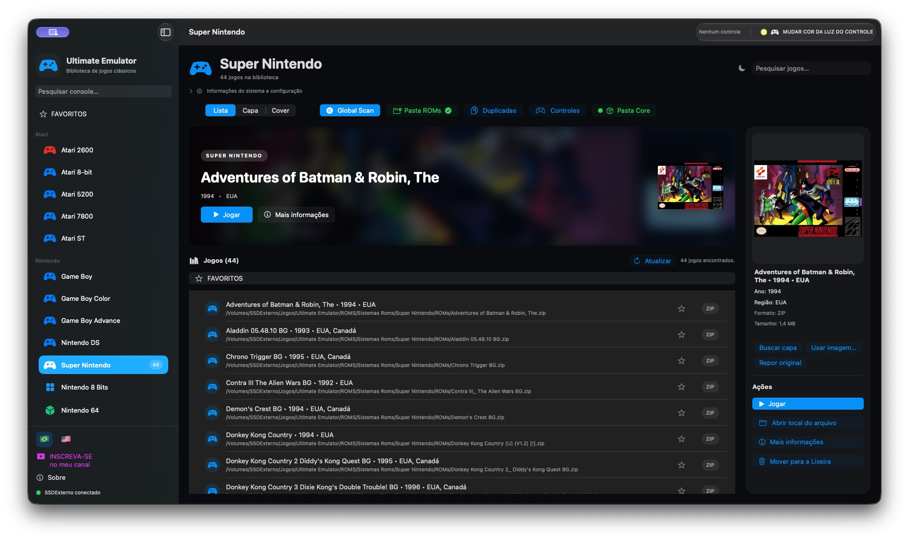
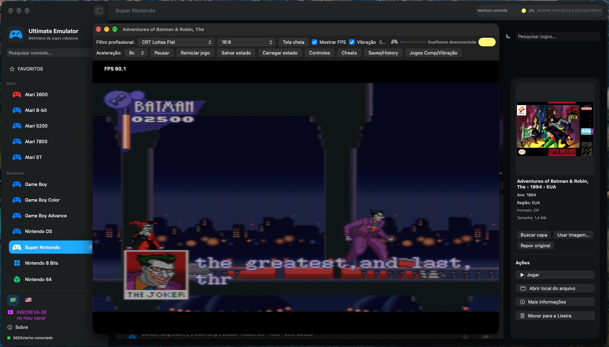
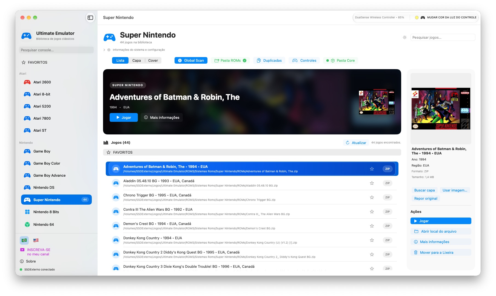
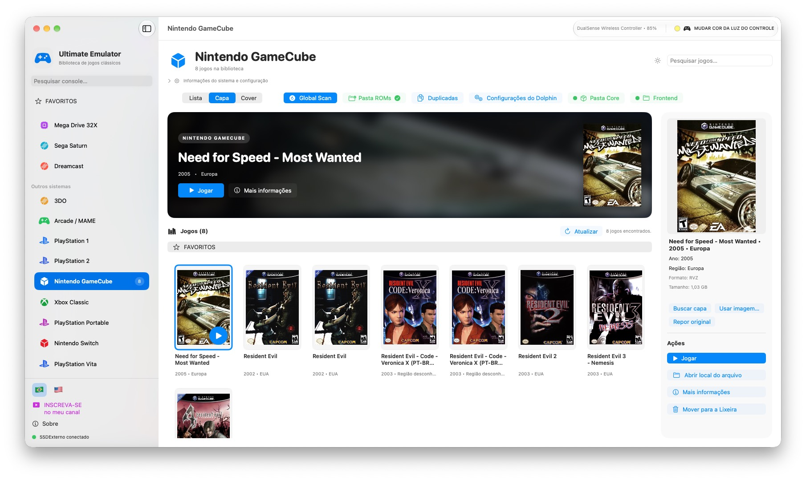

# Ultimate Emulator para macOS

Emulador e biblioteca de jogos clássicos para macOS, com uma interface unificada para organizar ROMs, capas, favoritos, saves e diferentes sistemas.

## Destaques

- Biblioteca organizada por plataforma, com busca e informações de cada jogo.
- Capas, visualização em lista, grade e Cover Flow.
- Favoritos agrupados por plataforma, seleção múltipla e remoção em lote.
- Suporte a saves, save states, controles e filtros de imagem.
- Integração com sistemas clássicos, RetroArch, MAME e Dolphin conforme a plataforma.
- Interface em português do Brasil e inglês, com modo claro e escuro.

## Capturas

| Biblioteca | Gameplay |
| --- | --- |
|  |  |

| Modo claro | Nintendo GameCube |
| --- | --- |
|  |  |

## Download para macOS

O pacote de distribuição sem jogos está hospedado no Google Drive:

[Baixar Ultimate Emulator para macOS](https://drive.google.com/file/d/1ao-IY9R1UIDVNHhnziKe9EPMK3KDmUlk/view)

O pacote não inclui ROMs. Depois de baixar, escolha a pasta de ROMs de cada sistema dentro do aplicativo.

## Aplicativos para Windows

Conheça a vitrine oficial com capturas, descrições e links de instalação:

[Rafael Software — aplicativos para Windows 10 e 11](https://rafaelpegado.neocities.org)

- [Social Video Downloader](https://apps.microsoft.com/detail/9p3sc1x00f77?gl=BR&hl=pt-BR) — vídeos, MP3, conversão opcional e legendas PT-BR.
- [Gerador de Legendas Automáticas](https://apps.microsoft.com/detail/9MT6RT55V2W8?hl=pt-br&gl=BR&ocid=pdpshare) — SRT, TXT, incorporação de legendas e exportação FCPXML.
- [Conversor MP4 Fácil](https://apps.microsoft.com/detail/9P2Q4LKLGQCS?hl=pt-br&gl=BR&ocid=pdpshare) — conversão para MP4, extração de MP3 e junção de vídeos.

## Requisitos

- macOS compatível com o build distribuído.
- ROMs e BIOS obtidas legalmente pelo usuário.
- Espaço adicional para os jogos, capas e saves.

## Projeto

Este repositório documenta a versão macOS e serve como ponto central para releases, screenshots e instruções. Componentes de terceiros e cores de emulação mantêm suas próprias licenças e não são redistribuídos automaticamente neste repositório.

## Outros projetos

- [Social Video Downloader — instaladores](https://github.com/rafaelpegadodasilva/SocialVideoDownloader-Releases)
- [Social Video Downloader — Windows ARM64](https://github.com/rafaelpegadodasilva/UltimateSocialVideoDownloader-ARM64)
- [Social Video Downloader — projeto](https://github.com/rafaelpegadodasilva/Social-Video-Downloader)
- [PDF Compressor — Windows x64](https://github.com/rafaelpegadodasilva/PDF-COMPRESSOR-x64-Build)
- [Canal Rafael_Info](https://www.youtube.com/@Rafael_info)

## Status

Em desenvolvimento contínuo, com foco em estabilidade, organização da biblioteca e experiência de uso no macOS.
